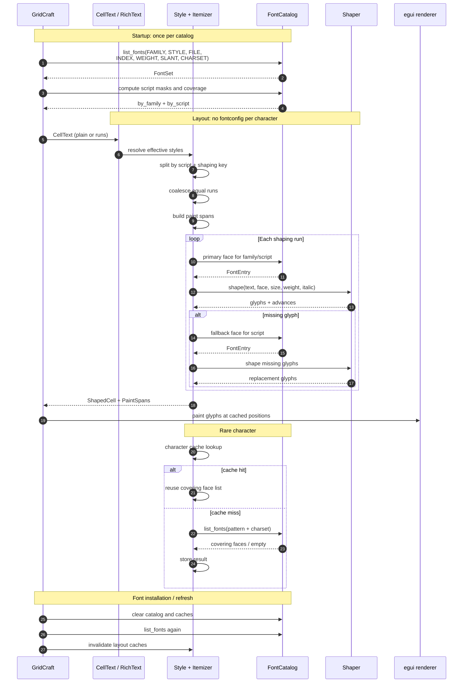
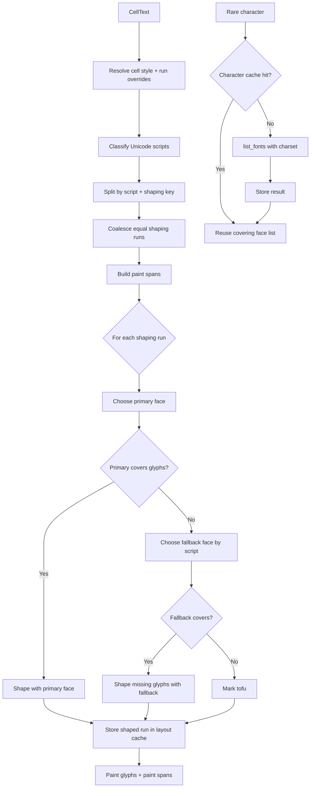

# Font discovery, fallback, and rich text on Linux

Status: design note and implementation map.

- Repository: `storytold/gridcraft`
- Branch: `port/ontario-037` (ported onto `origin/main` at `6a8eb4ff`; local only)
- HEAD when this revision was written: `a4b2da99 chore(ui): draw the layout probes from one scoped palette (#1231)`
- Last updated: 2026-11-07 (sections 3, 9, 10.5, 12 and 14 describe the port line)
- Related issue: `#1231`
- Current PR: `#1972` points at `fix/linux-fontconfig`; this branch has no PR

This document has three layers:

1. **Implemented** — what the code does today.
2. **Target** — the proposed font-catalog, rich-text, and shaping architecture.
3. **Not implemented** — known gaps, API limitations, and migration work.

Do not read a "Target" section as current behavior.

Rich text is part of the target architecture, not an appendix. It changes the
cell data model, the layout pipeline, font binding, editing, and file I/O. The
font-discovery work is a prerequisite, not a replacement for it.

---

## 1. Summary

Current Linux implementation:

- `fc-list` supplies face metadata (file, index, family, style, weight, slant)
  from fontconfig's cache; startup does not open every font file.
- Other platforms read each file with `skrifa`, under a 256 MiB per-file cap,
  and build the same `Face` catalog.
- The resulting `Face` catalog is cached in a process-wide `OnceLock`.
- `fc-match` resolves role families and script families.
- Its index is split into face + named instance; the instance is applied through
  `FontTweak::coords` so variable fonts keep the weight/slant fontconfig matched.
- `fc-match` results are cached in a thread-local `HashMap`.
- Selected workbook fonts are bound into egui lazily; binding still reads the
  whole font file.
- Font roles are published to `cell_family()` only after egui has activated the
  new font set. This avoids a frame that names a family egui does not have yet.

Target implementation:

- Fontconfig is called once at startup to build an in-memory `FontCatalog`.
- The catalog records, per face, which Unicode scripts it covers.
- Cell text can be plain or rich: a list of text runs with optional character
  styles.
- Layout resolves each run's style, itemizes by script and shaping key, shapes
  contiguous runs, and paints color/underline spans separately.
- egui performs per-glyph fallback inside each run.
- Rare characters are looked up by character, cached, and then reused.
- No per-frame fontconfig calls and no per-character `font_match`.

Main unresolved issues:

- First use of a large, previously unbound family can still freeze the UI for
  roughly 1–2 seconds because egui rebuilds its font atlas and glyph cache. That
  is separate from font discovery; see §8.
- Full rich text requires separating shaping attributes from paint attributes.
  `LayoutJob`/`LayoutSection` currently couple them.
- `fontconfig` 0.11 does not expose direct charset introspection; coverage sets
  or upstream API additions are required.

---

## 2. Goals, non-goals, and terminology

### 2.1 Goals

GridCraft must:

- show every installed font in the font picker;
- render workbook text in the chosen font;
- render CJK, Thai, Hebrew, symbols, and emoji without tofu;
- preserve per-character formatting in cell text;
- work on native Linux, Flatpak, macOS, Windows, and wasm;
- never panic because a font file is damaged or a family is not bound;
- avoid rescanning the filesystem or spawning fontconfig processes on every
  frame.

### 2.2 Non-goals

This document does not define:

- a bundled CJK font set;
- a new font file format;
- full CSS-style text layout;
- arbitrary per-character OpenType feature editing;
- a replacement for the platform text stack on macOS/Windows.

Fonts remain external assets. GridCraft must not bundle fonts outside the
`storytold/craft-fonts` policy.

### 2.3 Terminology

| Term | Meaning |
|---|---|
| Face | One font face inside a file. A TTC may contain several faces. |
| Family | Typographic family name, e.g. `Noto Sans CJK SC`. |
| Role | GridCraft's internal font slot: `ui`, `ui-bold`, `cell`, `cell-bold`, `cell-italic`, `cell-bold-italic`, `serif`, `mono`. |
| Script | Unicode script class: Latin, Han, Japanese, Korean, Thai, Hebrew, Symbols, Common. |
| Rich text | A cell text value made of runs, where each run may override the cell's character style. |
| Text run | A contiguous byte range with the same effective character style. Adjacent equal runs are merged. |
| Shaping key | The properties that affect glyph selection and positioning: face, size, weight, italic, features, language, script. |
| Paint span | Properties that affect drawing but not shaping: color, underline, background, border. |
| Coverage | Whether a face has glyphs for the sample characters of a script run. |
| `font_match` | Fontconfig best-match operation. It always returns a closest match, even if the font does not cover the requested charset. |
| `list_fonts` | Fontconfig filtered enumeration. With a charset pattern it returns only candidates matching that pattern. |

---

## 3. Current implementation

This section describes the code on this branch at HEAD `a4b2da99`. It states what
the code does now, not how it differs from another line: the comparison with
`fix/linux-fontconfig-0121` is in §10.5 and §12. Functions and files are the
anchors; line numbers are omitted on purpose because every phase moves them.

### 3.1 Startup, scan, and the font gates

`SheetApp::setup_context_for_language()` (in `crates/ui-egui/src/app.rs`) runs
once per context: it calls `fonts::start_scan()`, installs
`theme::font_definitions_for_language(language)` and applies the visuals. The
native and web entry points call it directly, so the scan starts even for an
empty session.

`start_scan()` (in `crates/ui-egui/src/fonts.rs`) starts the named background
thread (`font-scan`) once; the thread calls `catalog()`.

`catalog()` is a `OnceLock<Vec<Face>>`. It blocks only the first caller, which
is normally the background thread.

`scan_installed()` (in `crates/ui-egui/src/fonts.rs`):

1. On Linux, call `fontconfig_faces()`.
2. If it returns faces, use them.
3. Otherwise fall back to `scan_dirs(system_font_dirs())`.

`fontconfig_faces()` runs:

```text
fc-list -f "%{file}\t%{index}\t%{family[0]}\t%{family}\t%{style[0]}\t%{weight}\t%{slant}\t%{charset}\n"
```

with `LC_ALL=C` so family and style are the English names. Each record becomes a
`Face` directly: family, face index, weight mapped from fontconfig's
`FC_WEIGHT_*` constants to the 100–900 scale, italic from `FC_SLANT_ITALIC`
(`100`) and up, the serif hint from the family name, and the covered scripts from
`%{charset}`. Paths are kept byte-exact (a font path need not be valid UTF-8),
filtered to existing files with supported extensions (`ttf`, `otf`, `ttc`, `otc`),
and deduplicated by `(path, index)`. A record with fewer than eight fields, or an
empty file or family, is skipped rather than guessed at.

`%{charset}` keeps the script knowledge inside the metadata pass: no font file is
opened to learn coverage. The field lists the Unicode blocks the face covers
(`4e00-9fff 1f600-1f64f …`); `ScriptSet::of_charset()` turns it into bits by
bisecting the per-script `SAMPLES` pairs from `crates/ui-egui/src/script.rs`.

`scan_dirs()` (in `crates/ui-egui/src/fonts.rs`) recursively walks platform font
folders, canonicalizes directories to avoid symlink loops, and calls
`scan_file()` for each candidate.

`SheetApp::apply_font_state()` (in `crates/ui-egui/src/app/fonts.rs`) is the only
place the font set changes. Its gates, in order:

1. a language change that moves the Han order marks the set stale
   (`fonts_ready = false`);
2. `!fonts_ready` → `start_font_setup()`: the test harness installs
   `theme::pinned_font_definitions()` (system fonts off, for determinism),
   production calls `install_first_font_set()`. While `fonts_ready` is false
   `ui()` paints nothing and only asks for the next pass — the one remaining
   blank frame;
3. `fonts_rebind` → egui has activated the set built last pass, so publish
   `pending_roles` with `fonts::set_bound_for()` and clear the flag;
4. otherwise, once `fonts::scan_done()` and the workbooks' `(uid, revision)`
   changed, `rebind_workbook_fonts()`.

A pending synthetic step defers every font change by one pass, so a queued
screenshot never consumes a rebind.

### 3.2 Metadata-only face scanning (non-Linux)

`scan_file()` enforces `MAX_FONT_FILE` (64 MiB) and then calls `file_faces()`,
which uses `skrifa`'s `FileRef`/`FontRef`: `fonts()` iterates the faces of a plain
sfnt or a collection, `localized_strings` reads the typographic
family/subfamily (falling back to the legacy name IDs) in English or the first
available language, `os2().panose_10()` supplies the serif flag, and
`charmap()` supplies the coverage that becomes `Face::scripts`. Damaged files,
unreadable tables, and out-of-range table offsets yield no faces, not a panic.

Unlike the Linux path, this reads each candidate file once (peak memory is the
largest file, not the sum), because `skrifa` needs the bytes. The 64 MiB cap
bounds that read; it is not a claim that a larger font could not render.

### 3.3 Faces, families, and fontconfig named instances

`Face` (in `crates/ui-egui/src/fonts.rs`) contains:

```rust
pub struct Face {
    pub family: String,
    pub names: Vec<String>,
    pub path: PathBuf,
    pub index: u32,
    pub weight: f32,
    pub italic: bool,
    pub serif: bool,
    pub scripts: ScriptSet,
}
```

`names` keeps every family name the face carries, `family` first, then each
language's typographic and legacy names (`Malgun Gothic`, `맑은 고딕`), so a
workbook that names the font by any of them binds to it (#1898). On Linux the
list comes from `%{family}` in `fc-list`, which also reports aliases; elsewhere
it comes from the `name` table. `serif` is a catalog hint from the OS/2 panose
(or, on Linux, the family name); binding re-reads panose from the loaded bytes.
`scripts` is the coverage the catalog queries (`FontCatalog::families_covering`,
`font_for_script`); it is not used to pick a face inside a family.

Style names are converted to weight and italic flags by `style_weight()` and
`style_italic()`. On Linux the weight comes from `fc_weight()`
(in `crates/ui-egui/src/fonts.rs`), which maps fontconfig's OpenType-style
constants (`FC_WEIGHT_REGULAR` 80, `FC_WEIGHT_BOLD` 200) onto the CSS scale.
`FC_WEIGHT_EXTRABOLD` (205) has its own point at 800: it is equally far from
Bold (200) and Black (210), and while it was missing from the table
`min_by_key` rounded it down to 700 and tied it with Bold.

`FontCatalog` (in `crates/ui-egui/src/catalog.rs`) indexes the catalog once:
`FontEntry` mirrors `Face`, `by_name` maps every lower-cased name and alias to
entry indices, `by_script` maps a `ScriptClass` to the entries that cover it.
`installed()` takes that index from the scan; `families_covering(script)`,
`covers(script)`, `families()` and `font_for_script(script, serif, bold)` are
queries that never touch the file system.

`font_for_script()` prefers the design the platform would pick — Noto Sans/Serif
CJK SC/JP/KR for Han, Noto Sans/Serif Thai, Abyssinica SIL for Ethiopic and so on
— then accepts any covering family, but never an auxiliary design (a name
containing mono, symbol, emoji, dingbat, icon, webding, wingding or math) unless
the script is `Symbols`. Ties are broken by a `rank()` tuple — serif mismatch,
slant, distance from weight 400/700, family name — so the choice cannot depend on
`fc-list` ordering.

`families()` builds the font picker list: the standard `ribbon::FONTS` names
first, then installed family names A–Z, deduplicated case-insensitively. It never
blocks; before the scan finishes it returns only the standard names.

A fontconfig `%{index}` carries two fields: the face index in the low 16 bits and
a **1-based named instance** in the high 16 bits (`0` means the font's default
instance). `fc_index_parts()` splits them; `try_load()` and `load_face()` keep
the low half in `FontData::index` and apply the instance through
`FontTweak::coords` (`apply_named_instance()`, reading the axis values with
`skrifa`). Without that split a variable font always renders its default
instance: fontconfig resolves `Noto Sans:weight=bold` to named instance 3
(wght 700), whose raw index is `262144`, and Noto Sans CJK's default instance is
Thin (wght 100), so bold text and serif CJK text came out in the wrong weight.
Do not gate this on fontconfig's `%{variable}`: it returns `False` for both
variable TTFs and named instances inside variable collections on
fontconfig 2.17, so it cannot tell a static face from a named instance.

`align_fallback()` (in `crates/ui-egui/src/fonts.rs`) tags every loaded face
with `FallbackAlign::Baseline` — the family's ascent decides where the glyphs
sit — except symbol and icon families (`is_symbol_family()`: emoji, symbol,
dingbat, icon, webding, wingding, awesome), which keep `Center`. epaint defaults
to `Center`, which put a CJK fallback ~0.3 em below the Latin baseline (upstream
#8802); the tweak is applied where each face enters the set: `bind_faces()`,
`try_load()` and `add_craft_fonts()`.

### 3.4 Font roles and `fc-match`

`build_role_chain()` (in `crates/ui-egui/src/theme/font_setup.rs`) builds one
family per role. On Linux it first asks `fontconfig_role(role)` for the design
name and resolves it with `fc_match()`:

| Role | Pattern |
|---|---|
| `ui`, `cell` | `sans-serif` |
| `ui-bold`, `cell-bold` | `sans-serif:weight=bold` |
| `cell-italic` | `sans-serif:slant=italic` |
| `cell-bold-italic` | `sans-serif:weight=bold:slant=italic` |
| `serif` | `serif` |
| `mono` | `monospace` |

`math`, `math-italic` and `math-bold` have no fontconfig pattern and always use
`candidates(role)`, the hard-coded path table (`SFNS.ttf`, `segoeui.ttf`,
Carlito, DejaVu, Fedora's package folders, …), which is also the fallback when
`fc_match()` finds nothing.

`fc_match()` (in `crates/ui-egui/src/fonts.rs`) first checks the thread-local
`FC_MATCH_CACHE`. On a miss it runs:

```text
fc-match -f "%{file}\n%{index}\n" <pattern>
```

Results, including failures, are cached for the rest of the process. There is no
invalidation: fonts installed while GridCraft is running are picked up only after
restart.

`try_load()` loads the first parseable candidate and inserts it as `sys-{role}`.
A missing bold role reuses `sys-ui`; a missing `cell-*` role reuses `sys-cell`;
`math-italic`/`math-bold` chain the math face and then the serif face. Every role
then extends egui's base proportional (or monospace) chain, the bundled Hack face
(0.37 keeps it only in `Monospace`, while the ribbon draws ▲ ▾ ↳ as text), and
finally the script fallback keys chosen by the caller. Keys without data are
dropped, so a chain never names a face egui does not have.

### 3.5 Font definitions and script fallback

`font_definitions_roles()` (in `crates/ui-egui/src/theme/font_setup.rs`) returns
`(FontDefinitions, Vec<String>)` without publishing the role registry;
`font_definitions_with()` is the immediate wrapper that also calls
`set_bound_for()`. Both call `font_definitions_impl(language, used, scripts,
bold_scripts, system)`:

1. start from egui's defaults;
2. `wanted = wanted_scripts(language, scripts)` (in
   `crates/ui-egui/src/theme/font_fallback.rs`): the workbook's scripts, unioned
   with the interface language's scripts (`interface_scripts()`: Han for Chinese;
   Han and Japanese for Japanese; Korean for Korean) and with `Symbols`. An empty
   workbook set means "nothing known yet" and widens to `ScriptSet::all()`;
   `known` records whether it was non-empty;
3. load the sans faces with `load_fallback(fonts, han, false, wanted, known)` and
   the serif faces with `true` only when `want_serif`: a workbook family reads as
   serif (`family_name_is_serif()`: Times, Georgia, Cambria, Garamond, any
   `*Serif*` that is not a `*Sans*` name) or an installed family actually has a
   serif face. Noto Serif CJK alone is ~55 MB, so a sans-only workbook must not
   pay for it;
4. build the eleven roles (`ui`, `ui-bold`, `cell`, `cell-bold`, `cell-italic`,
   `cell-bold-italic`, `serif`, `mono`, `math`, `math-italic`, `math-bold`). A
   bold role takes the bold script faces with the regular ones behind them
   (`with_regular_faces()`), so a Calibri cell drawing its Latin in Carlito Bold
   also draws its Han in a bold CJK face, and a script whose bold face could not
   be read falls back to regular instead of tofu;
5. bind installed workbook families: `faces_of()` then `bind_faces()`, with the
   script chain chosen by the family's own design (`script_chains()`: a serif
   family gets the serif faces first and the sans faces behind them, so Chinese in
   a Times New Roman cell is not Noto Sans);
6. bind the OS substitute for a standard Excel name that is not installed
   (`substitute_family()`): `fc-match` resolves `Times New Roman` to
   `Liberation Serif`, `Cambria` to `Caladea`, `Courier New` to
   `Liberation Mono`, and `bind_faces()` binds that family's four roles **under
   the requested name**, so bold and italic survive. Only `ribbon::FONTS` names
   qualify: fontconfig answers any pattern, so a misspelt name would silently
   bind DejaVu Sans and hide the miss. macOS and Windows resolve the standard
   names themselves and bind nothing extra (#1231);
7. `bind_cell_fallback()` inserts the cell face before the script fallbacks of
   the interface families, so the formula bar can draw whatever a cell can (#349);
8. sets `FontFamily::Proportional` to the `ui` chain;
9. appends the optional craft-fonts faces (`append_craft_faces()`) at the very
   end of every family, so the host's own design wins and the permitted OFL faces
   only cover what the image lacks;
10. drops unparseable faces (`drop_unparseable_fonts()`) and keeps in the bound
    list only families that still have a non-empty chain.

`fallback_faces()` returns `ScriptFace { key, sans, serif, covers }` entries in
chain order; `covers` decides whether the face loads for a given `wanted` set:

| Key | Script | Serif companion |
|---|---|---|
| `sys-cjk-han-zh` / `sys-cjk-han-ja` | Han (SC / JP; order from `HanOrder`) | `sys-cjk-han-zh-serif` / `sys-cjk-han-ja-serif` |
| `sys-cjk-hangul` | Korean | `sys-cjk-hangul-serif` |
| `sys-thai` | Thai | `sys-thai-serif` |
| `sys-lao` | Lao | `sys-lao-serif` |
| `sys-khmer` | Khmer | `sys-khmer-serif` |
| `sys-hebrew` | Hebrew | `sys-hebrew-serif` |
| `sys-arabic` | Arabic | `sys-arabic-serif` (Naskh) |
| `sys-devanagari` | Devanagari | `sys-devanagari-serif` |
| `sys-myanmar` | Myanmar | — (Padauk has one design) |
| `sys-tibetan` | Tibetan | — (Jomolhari has one design) |
| `sys-yi` | Yi | — (Noto Sans Yi) |
| `sys-symbols` / `sys-symbols-2` | symbols | — |

A script in `wanted` that none of them covers is bound by
`load_catalog_fallback()` as `sys-script-<script>` (plus
`sys-script-<script>-serif`), so Bengali and Ethiopic, and any script this host
installs under a family the table does not name, still render. That step is
skipped when `!known`, so an empty workbook does not load one face per installed
script; a path already loaded is skipped, because one CJK collection serves
several scripts; Latin is always skipped, because the interface and bound
families cover it.

Bold scripts take a parallel path: `load_bold_script_faces()` asks
`font_for_script(script, serif, bold)` for a weight ≥ 600 face, then tries the
other bold faces of the catalog that cover the script, and only then gives up.
The result keys are `sys-script-<script>-bold` / `sys-script-<script>-bold-serif`.

That walk matters because fontconfig ranks a variable collection's named instance
above the same family's static bold file: `Noto Sans:weight=bold` resolves to
`NotoSansCJK-VF.ttc` first, which egui cannot parse, so the walk continues to
`NotoSansCJK-Bold.ttc` instead of leaving the script at regular weight.

Each script function asks fontconfig first on Linux (`sans-serif:lang=…`,
`serif:lang=…`, Arabic's serif companion is Noto Naskh Arabic), then appends the
hard-coded paths in `LINUX_CJK_FALLBACK_DIRS` and the platform-specific paths.

`load_fallback()` loads at most one file per key and records loaded paths within
one call. A face whose `covers` does not intersect `wanted` is skipped before any
candidate path is tried, so a Latin-only workbook never opens the CJK or Thai
faces.

### 3.6 Binding workbook fonts

`used_fonts()`, `used_scripts()` and `used_bold_scripts()` (in
`crates/ui-egui/src/app/fonts.rs`) walk every open workbook once:

- `used_fonts()` collects the families in use — cell styles, theme heading/body
  fonts, shape text fonts — sorted and deduplicated;
- `used_scripts()` returns the `ScriptSet` of the workbook's text (cell string
  values and shape text), capped at `SCAN_LIMIT` (200 000 characters) so a huge
  sheet cannot make a rebind expensive;
- `used_bold_scripts()` does the same for text in a bold style only, so turning a
  CJK cell bold adds the bold face instead of restarting with tofu.

`installed_among()` filters the family list against the catalog, sorts and
deduplicates it. For each family the builder binds `faces_of(family)`.

`bind_faces(fonts, family, faces, fallback, bold_fallback)` (in
`crates/ui-egui/src/fonts.rs`):

- returns no roles for an empty face list;
- for each `(bold, italic)` combination, calls `pick_face()`;
- chains the primary face with the family's regular face;
- loads the primary first, so its real panose is available;
- picks the fallback column from the primary face and appends those keys —
  `bold_fallback` for a bold role when it is non-empty, `fallback` otherwise,
  with the regular keys appended behind a non-empty bold set;
- records, for an italic role, which scripts the family's italic faces actually
  cover (`italic_coverage()`): `Some(set)` is the coverage, `None` no coverage;
- inserts `FontFamily::Name("fnt:{family}:{b|n}{i|n}")` and returns the bound
  role keys.

`pick_face()` chooses the eligible face **nearest the role's own weight** — 700
for bold, 400 for regular — within the requested slant, and only then falls back
to the family's regular face. Taking the first eligible face went wrong once
`fc-list` began reporting every named instance of a variable font:
`faces_named()` hands the catalog over in ascending weight order, so the bold
role took `SemiBold` and the italic role took `Thin Italic` or `Light Italic` —
on the host this hit Noto Sans, Open Sans, Montserrat, Adwaita Sans and 51 more
families that ship the full weight range (#1231). A missing italic still leaves
an italic role bound to a regular face; the cell painter then shears it (§3.10).

### 3.7 Rebind and flicker avoidance

`SheetApp` fields (in `crates/ui-egui/src/lib.rs`):

- `fonts_ready: bool`, `fonts_set: bool`
- `fonts_rebind: bool`
- `fonts_bound: Vec<String>` (the families the current set was built for)
- `fonts_scripts: ScriptSet` (the scripts it was built for)
- `fonts_bold_scripts: ScriptSet` (the scripts it loaded bold faces for)
- `fonts_seen: (u64, u64)` (the workbooks' folded `(uid, revision)`)
- `fonts_defs: Option<egui::FontDefinitions>` (the last set, for merging)
- `pending_roles: Vec<String>` (published once egui has the new set)

Flow:

1. If `!fonts_ready`, install the first font set and wait for the next pass. With
   a workbook already open the set is built from its `used_fonts()`,
   `used_scripts()` and `used_bold_scripts()` straight away
   (`install_first_font_set()`), waiting for `fonts::catalog()` first: a script
   the hand-written fallback list does not cover (Bengali, Ethiopic) can only
   come from the catalog, and binding it one pass later rebuilt the glyph atlas
   after the cells had painted — those rows showed tofu for a second or two
   (#1231). An empty workbook keeps the non-blocking path.
2. Else if `fonts_rebind`, egui has activated the set made on the previous pass:
   publish `pending_roles` with `fonts::set_bound_for()` and clear the flag.
3. Else if the scan is done and `(uid, revision)` changed, recompute the three
   values. If any differs, build with `font_definitions_roles()`, merge the
   previous set into the new one (`merge_fonts()`), `ctx.set_fonts()`, store
   `pending_roles` and the new values, set `fonts_rebind`, and request a repaint.

`merge_fonts()` keeps every family and face of the old set, so a frame painted
with the previous set never names a family egui does not have — the panic that
followed a rebuild (`FontFamily::Name(..) is not bound to any fonts`, once
`fnt:Arial:*` came from the default theme and a Calibri-only workbook dropped
it). `set_bound_for()` publishes only the roles the new definitions actually
carry, and `clear_bound()` empties the registry when a new app starts, so one
test's bindings cannot leak into the next.

The UI no longer returns early solely because `fonts_rebind` is true: that early
return was the one-frame blank flash. Only the first pass of a context waits.

Comparing the scripts matters as much as the family list: a cell whose text gains
a script after the fonts were bound (typing Thai into a Latin sheet) would
otherwise never rebuild the set, and the new script would draw tofu until a
restart (#1231). The same holds for bold: a CJK cell turned bold needs the bold
faces, so `fonts_bold_scripts` is part of the comparison.

### 3.8 The current rich-text gap

GridCraft cells currently have one character style per cell. There is no
per-character text model.

Evidence:

- `crates/ui-egui/src/grid/quadrant.rs` lays a cell out with `cell_job()`, which
  takes one font and one color; it splits the text by script only, to decide
  where a synthetic italic applies (§3.10).
- `crates/ui-egui/src/formula_bar.rs` builds sections only to color
  formula-reference tokens; this is not a cell rich-text model.
- XLSX shared strings are flattened to a single string:
  - `crates/xlsx/src/xml.rs` (`rich_text()` returns `String`, dropping `<rPr>`)
  - `crates/xlsx/src/sheet_read/parts.rs` and `crates/xlsx/src/sheet_read.rs`
    call it for inline and shared strings.
- There is no engine/model type that stores a cell's character runs, and no
  editing operation that applies a style to a character range.

Consequences:

- a workbook with per-character formatting loses that formatting on import;
- saving rewrites a single-run string, not the original `<r>` runs;
- the UI cannot apply bold/italic/color to part of a cell;
- the layout layer never has to reason about style boundaries, which is why the
  current architecture looks simpler than it is.

### 3.9 Current limitations

| Limitation | Effect |
|---|---|
| `fc-match` for every role pattern | Seven subprocess calls per role set; cached per process afterwards. |
| `fc-list` subprocess | No direct fontconfig library access; extra process and parsing. |
| First bind reads whole font | Large CJK font can read 56 MiB; cold page cache can take seconds. |
| Opening a workbook waits for the font scan | The first font set is built once, from the workbook's scripts, so opening blocks for one `fc-list` run (~50 ms); without fontconfig every installed file is parsed instead, which can take seconds. |
| One blank frame per context | `ui()` paints nothing until `fonts_ready`; it is a single pass, but it is still a blank window on a slow machine. |
| `try_load` checks parseability, not script coverage | An `fc-match` substitute may be chosen even if it lacks the script. |
| `families()` rebuilds the list on every call | The ribbon calls it per frame; potentially wasteful. |
| Missing bold face | A missing bold face still renders as regular. Only bound role families are judged: the built-in `cell-*`/`SERIF`/`MONO` chains are left upright. |
| Missing italic face | Slanted per script run by the painter (§3.10); the in-cell editor and the formula bar do not slant yet. |
| No cache invalidation | Fonts installed while running are not picked up until restart. |
| `ScriptSet` is full | All 16 bits are used (Latin … Ethiopic); a new script class needs the set widened to `u32` first (§13 question 15). |
| An empty workbook asks for everything | Until the first text is seen, `wanted_scripts()` returns `ScriptSet::all()`; an empty sheet therefore loads every installed fallback. |
| Latin never asks the catalog | The interface and bound families cover Latin, so `load_catalog_fallback()` skips it. |
| A rebuilt set keeps the old faces | `merge_fonts()` keeps the new set a superset, so faces carried for one workbook stay resident until restart. |
| Bold scripts need a bold face from the host | `sys-script-<script>-bold` comes from the catalog (weight ≥ 600); a host without one keeps the regular face. The Flatpak installs no CJK font, so this is entirely the host's call. |
| No per-cell reading order | Excel's `<alignment readingOrder="1|2">` is neither read nor written; only the sheet-wide `rightToLeft` mirrors the grid. |
| Tofu instead of a panic | A glyph nothing can draw is drawn as tofu (`MissingGlyphPolicy::Tofu`); the bookkeeping bug is logged, not fatal. |
| No rich-text model | Per-character formatting is lost; XLSX runs are flattened. |

### 3.10 Painting and input paths

Cell text:

- `cell_job()` (`crates/ui-egui/src/grid/quadrant.rs`) splits the text with
  `script::split_runs()` and turns italics on per run only where the family's
  italic faces do not cover the script (`italic_coverage()`), so a Calibri cell
  draws its Latin in Carlito Italic and shears its Han.
- `layout_job_or_default()` catches epaint's `FontFamily::Name(..) is not bound
  to any fonts` and retries with the proportional family, logging the role;
  `bound_font()` swaps an unbound `fnt:` family for `Proportional` before the
  first attempt.
- `shared_baseline()` (same file) undoes epaint's per-section line growth: a
  fallback face that reaches deeper than the font's descent grows only its own
  section, and bottom alignment then lifts that script off the row's baseline
  (Devanagari in an italic Times New Roman cell sat 7 px high at 19.2 px). It
  records the row's first glyph baseline and moves every other glyph onto it.
  **Moving `glyph.pos.y` alone is not enough**: epaint tessellates each row into
  `row.visuals.mesh` during layout and painting reuses that mesh
  (`crates/epaint/src/tessellator.rs`), so the quads of the moved glyphs are
  shifted as well (`first_vertex .. next.first_vertex`, clipped to
  `glyph_vertex_range`), and `mesh_bounds` grows by the shift. Doing only the
  first half moved the whole line through `ink_insets()` and looked "half
  fixed".
  Probe (used to verify it, not shipped): with `GRIDCRAFT_BASELINE` set, the
  paint path drew the row's corrected baseline as a 1 px red line and each
  glyph's raw (pre-correction) baseline as a 1 px green line spanning only that
  script's glyphs; a green line on top of the red one means aligned, and ±1 px
  is the accepted tolerance. Non-italic cells have a single section, so their
  raw baseline equals the corrected one and only the red line is visible.
- The in-cell editor and the formula bar draw through one `TextEdit`
  (`editor_widget()` in `crates/ui-egui/src/formula_bar.rs`): its layouter
  splits each colour span by script with `append_scripted()` and sets
  `format.italics` from `italic_coverage()` like `cell_job()` does, then runs
  the galley through `shared_baseline()`. Without that, an editing italic cell
  lost its synthetic slant and its mixed-script baselines — the `TextEdit` knows
  nothing about per-script italics or epaint's per-section growth.
  Its field is also anchored by ink, not by the row: `editor_text_top()` puts the line box
  so the highest ink starts `2 z` below the cell's top edge — the same rule
  `cell_text_y(VAlign::Top, …)` applies to the cell's own text, so a tall row neither pushes the
  The editor takes its line box top from the same `cell_text_y()`/`wrapped_cell_text_y()` the cell
  paints with, for the cell's own vertical alignment, so entering or leaving the edit does not move
  the text (`the_editor_text_follows_the_cells_vertical_alignment`).
  The caret and selection come from `TextEdit`'s row boxes, which the baseline fallback inflates:
  `trim_row_boxes()` trims each row's box to the cell font's own line height while the glyphs keep
  their positions (`the_caret_covers_the_text_line_and_not_the_fallback_box`).

- `every_section_of_a_line_shares_one_baseline()` (`crates/ui-egui/src/grid/tests.rs`)
  lays out a two-section line and asserts that every glyph sits on one
  baseline.
- Vertical placement is ink-based (`cell_text_y()`, `wrapped_cell_text_y()`,
  `ink_insets()` in `crates/ui-egui/src/grid/cell_paint.rs`): top alignment
  starts the ink `2.0 * z` below the cell edge, center centers the ink, bottom
  keeps `BOTTOM_TRAIL` (0.25) of the trailing descent under the ink; a wrapped
  line taller than the row is clamped so only whole lines show.
- `general_halign()` (`crates/ui-egui/src/grid/cell_paint.rs`) right-aligns
  right-to-left text under General alignment, using `script::is_rtl()` (the first
  strong character decides) — numbers right, booleans and errors centered.
- `theme::apply()` turns `subpixel_binning` off (epaint's own note says it makes
  text blurrier), which sharpens edges 1.5–2.5 % without changing advances.

Input:

- While the grid holds the keyboard, `publish_ime()`
  (`crates/ui-egui/src/grid/interact.rs`) publishes an `IMEOutput` for the
  active cell. egui only enables an input method for a focused `TextEdit`
  (`owns_ime_events` is just `has_focus`), and a single click on a cell leaves
  the focus on the grid, so without this the first key arrived as `Event::Text`
  and was typed into the cell while the input method started composing from the
  second key (#1231).
- A preedit is stored in `SheetApp::ime_compose` and drawn in place of the cell's
  value (it does not open the editor — moving focus would reset the input
  context). A commit opens the edit with the finished text.
- A cell edit is a `TextEdit`, so once it has focus the input method drives it
  directly; the grid stops handling text while an editor is open.
- The app keeps the native Wayland backend when the session has one
  (`apps/gridcraft/src/main.rs`); the X11 path only receives XIM events, which
  delivered no preedit and no commit. `GRIDCRAFT_X11=1` forces X11 for file
  drag-and-drop testing.

---

## 4. Constraints and failure modes

### 4.1 egui has no font discovery

egui/eframe does not enumerate system fonts. It only knows the font data given to
`Context::set_fonts`. A `FontFamily::Name` that was never bound is not a valid
fallback; using it can panic or produce no text.

GridCraft therefore has to do both jobs:

1. discover installed families and faces;
2. bind the files a workbook actually uses into `egui::FontDefinitions`.

### 4.2 Hard-coded font paths are not portable

Different distributions put fonts in different directories:

- Debian/Ubuntu: `/usr/share/fonts/truetype/...`
- Fedora: `/usr/share/fonts/google-noto-sans-cjk-fonts/...`
- Arch: `/usr/share/fonts/noto-cjk/...`
- Flatpak: host fonts appear under `/run/host/fonts/...`
- ChromeOS Crostini: `/usr/share/fonts/chromeos/...`

A fixed list of paths will miss at least one of them. This was the original
Flatpak CJK tofu bug: the sandbox had no CJK font at any path in the hard-coded
list, even though fontconfig could see `/run/host/fonts`.

### 4.3 Fontconfig configuration differs between host and Flatpak

The host and the Flatpak sandbox do not have identical fontconfig configurations:

- host fontconfig 2.17.0; sandbox 2.17.1;
- `/etc/fonts/fonts.conf` differs in size and hash;
- the sandbox adds `05-flatpak-fontpath.conf` and `50-flatpak.conf` for
  `/run/host/fonts`, `/run/host/local-fonts`, and `/run/host/user-fonts`;
- Fedora's font-package alias files are not all mounted inside the sandbox.

Observed differences:

| Query | Host | Flatpak sandbox |
|---|---|---|
| `serif` | Noto Serif CJK SC | Noto Sans CJK SC |
| `monospace` | Noto Sans Mono CJK SC | Noto Sans CJK SC |
| `sans-serif:lang=th` | Noto Sans Thai | FreeSerif |
| `sans-serif:lang=he` | Noto Sans Hebrew | DejaVu Sans |

Consequence: do not rely on generic `serif`/`monospace` results alone. Use an
explicit family when possible, and validate coverage with a charset query.

### 4.4 `font_match` is not a coverage query

`fc-match`/`Fontconfig::font_match` means "closest match", not "font that covers
these characters". If no font covers the requested script, fontconfig still
returns a substitute. That substitute may parse and render, but produce tofu.

Use one of:

- `list_fonts` with a charset pattern and treat the result as a coverage set;
- `Pattern::sort_fonts(UnicodeCoverage::Trim)` plus explicit verification;
- after exposing the missing APIs, `Pattern::charset()` + `CharSet::has_char`.

### 4.5 epaint couples shaping and paint

`LayoutSection` is delimited by `TextFormat`. `TextFormat` contains both shaping
properties (font, size) and paint properties (color, underline, background).
Changing only the color therefore splits the section and can discard kerning
that would otherwise be available inside one shaping run.

This is the central layout constraint for rich text:

- per-character font changes work with sections;
- per-character color changes also work visually, but may lose kerning at color
  boundaries;
- full quality requires shaping runs and paint spans to be independent.

### 4.6 Large fonts and atlas rebuilds

The first time a large unbound CJK family is used, GridCraft must:

1. read the whole font file;
2. add `FontData` to `FontDefinitions`;
3. call `Context::set_fonts`;
4. let egui rebuild the font atlas and glyph cache.

Caching avoids repeated `fc-match` and repeated file reads, but it does not make
the first atlas rebuild free. The remaining freeze is a layout/atlas problem,
not a font-discovery problem.

### 4.7 Invariants

1. `cell_family()` only returns an egui family that has data.
2. `FontData::index` is a face index; a fontconfig named instance is applied
   through `FontTweak::coords`, never by putting it in the index.
3. A failed font parse costs one fallback, never a panic.
4. The UI thread never scans font directories.
5. Normal layout never spawns `fc-match` per character.
6. A rich-text run range is valid UTF-8 boundaries and never overlaps another
   run.
7. A paint span never changes glyph positions.

---

## 5. Target architecture

### 5.1 Layers

```text
CellText (plain or RichText)
  → resolve_style: cell style + run overrides
  → itemize: script + shaping key
  → shape: one contiguous shaping run at a time
  → paint spans: color/underline/background
  → layout cache
  → egui rendering
```

Font discovery is upstream of this pipeline:

```text
fontconfig / fc-list / directory scan
  → FontCatalog
  → role selection and script coverage
  → shaping run fallback
```

### 5.2 Rich-text data model

```rust
pub enum CellText {
    Plain(Arc<str>),
    Rich(RichText),
}

pub struct RichText {
    pub runs: Vec<TextRun>,
}

pub struct TextRun {
    /// UTF-8 byte range in the cell's logical text.
    pub range: Range<usize>,
    /// None = inherit the cell style.
    pub style: Option<CharStyle>,
}

pub struct CharStyle {
    pub font: Option<String>,
    pub size: Option<f32>,
    pub bold: Option<bool>,
    pub italic: Option<bool>,
    pub underline: Option<Underline>,
    pub strike: Option<bool>,
    pub color: Option<Color32>,
    pub vert_align: Option<VertAlign>,
    pub charset: Option<u32>,
    pub scheme: Option<String>,
}
```

Rules:

- the cell style is the base;
- the run style is an override;
- resolve to an effective `CharStyle` before layout;
- coalesce adjacent runs with equal effective styles;
- reject or repair overlapping ranges;
- empty runs are not stored;
- ranges are byte ranges, not char indices, so selection and XLSX offsets stay
  stable.

The exact field set should follow the XLSX `<rPr>` attributes that GridCraft
supports. Unsupported attributes must either be preserved as raw XML or dropped
with an explicit test.

### 5.3 Style resolution

```text
effective_style(run) = merge(cell_style, run.style)
```

Only effective style differences split shaping runs. A run with
`color = red` and the same font as its neighbor is one shaping run with a paint
span, not two shaping runs.

#### 5.3.1 Weight and slant

Style is resolved **inside one family**. Choosing the family (explicit run
font, role, or script fallback) happens first; never cross families to repair
the style of an installed family.

```rust
pub struct StyleRequest { pub weight: f32, pub italic: bool } // default 400.0, false
pub enum SlantFallback { Exact, Oblique, Axis, Synthetic, Upright }
pub struct ResolvedFace { pub face: usize, pub weight_gap: f32, pub slant: SlantFallback }
```

1. **Exact.** Same weight and slant. An italic request also accepts `oblique`;
   the model has no separate oblique flag. An upright request never selects an
   italic or oblique face.
2. **Variable axis.** A face whose `wght` (or `slnt`) axis covers the request is
   clamped to `[min, max]` and receives the axis value through
   `FontTweak::coords`. This is exact and takes precedence over rounding to the
   nearest static face.
3. **Nearest static weight**, within the requested slant, following CSS Fonts 4
   §5.2.2:
   - `400 <= w <= 500`: `[w, 500]` ascending, then `< w` descending, then
     `> 500` ascending;
   - `w < 400`: `<= w` descending, then `> w` ascending;
   - `w > 500`: `>= w` ascending, then `< w` descending.

   Equal distance prefers the heavier face for `w >= 600` and the lighter face
   for `w <= 500`; a remaining tie takes the lower face index.
4. **Synthetic style**, only when the family is installed but has no matching
   face. Italic already works: epaint shears any glyph whose
   `TextFormat::italics` is set (the top vertices move by a quarter of the font
   size, about 14°; advances and the cell width do not change). The judgement is
   per script run, not per cell: `bind_faces()` records which scripts the role's
   real italic faces cover (`fonts::italic_coverage()`), and the grid lays the
   cell out as one section per `script::split_runs()` run, slanting only the runs
   beyond that set. That matters because a substitute family often has a
   Latin-only italic — Calibri → Carlito Italic — while the Han glyphs come from
   a CJK fallback face that ships no italic at all. Bold still needs a stroke or
   a double-draw offset, which changes measured widths, so it stays deferred to
   Phase 4 (§13.13). A degraded role keeps the face's advances and is logged at
   debug level.
5. **Substitute family**, only when the requested family is not installed: rank
   the script/role candidates by style match first, then by candidate order. A
   candidate with the exact style beats an earlier candidate with only regular.
6. **Degrade.** If nothing matches or synthesises, return the upright or lighter
   face with an explicit `SlantFallback::Upright` or non-zero `weight_gap`, and
   record it in `used_fonts()`. Never present it as an exact match; this is the
   §5.10 rule that a missing italic must not silently bind regular.

Under egui, style is part of the family key, not a shaping argument: `FontId`
carries only `family + size`, and the one style epaint can synthesise is the
italic shear of `TextFormat::italics`. The four roles
(`cell`, `cell-bold`, `cell-italic`, `cell-bold-italic`) encode weight 400/700
and `italic`. A numeric weight needs a key per weight value the workbook
actually uses (`used_fonts()` must return the used weight set), never a key per
possible weight: every added key can load another large CJK face.

### 5.4 Font catalog

```rust
#[derive(Clone, Copy, Debug, PartialEq, Eq)]
pub enum ScriptClass {
    Latin,
    Han,
    Japanese,
    Korean,
    Thai,
    Lao,
    Hebrew,
    Arabic,
    Devanagari,
    Khmer,
    Myanmar,
    Tibetan,
    Yi,
    Bengali,
    Ethiopic,
    Symbols,
    Common,
}

/// One bit per class, `Common` excepted. Currently `u16`, and all 16 bits are in
/// use (fourteen original classes, then Bengali and Ethiopic): a seventeenth
/// class needs `u32`. That is a one-line change here plus the `bit()` numbers,
/// because callers only use `has`/`with`/`intersects`/`iter`.
#[derive(Clone, Copy, Debug, Default)]
pub struct ScriptMask(u16);

#[derive(Clone, Debug)]
pub struct FontEntry {
    pub family: String,
    pub style: String,
    pub path: PathBuf,
    pub index: u32,
    pub weight: f32,
    pub italic: bool,
    pub scripts: ScriptMask,
}

pub struct FontCatalog {
    pub fonts: Vec<FontEntry>,
    pub by_family: HashMap<String, Vec<usize>>,
    pub by_script: HashMap<ScriptClass, Vec<usize>>,
}
```

Rules:

- `FontEntry` owns only plain data; it is `Send` and can live in a shared
  catalog.
- Do not store `fontconfig::Pattern`, `CharSet`, or `FontSet` in the catalog;
  they are `!Send`/`!Sync`.
- `by_script` is sorted by preference, not by fontconfig order alone.
- A catalog entry may be an explicit family used by a rich-text run; it must not
  be limited to cell-level `used_fonts()`.

### 5.5 Startup and catalog build

1. Create one `Fontconfig` handle per worker thread that needs it.
2. Call `list_fonts` once with an `ObjectSet` including:
   - `FC_FAMILY`
   - `FC_STYLE`
   - `FC_FILE`
   - `FC_INDEX`
   - `FC_WEIGHT`
   - `FC_SLANT`
   - `FC_CHARSET` (if the wrapper can read it)
3. Convert each result to `FontEntry`.
4. Compute `scripts`:
   - preferred: `Pattern::charset()` + `CharSet::has_char()` on sample chars;
   - fallback: `list_fonts` with a charset pattern per script, then record
     `(path, index)` membership.
5. Build `by_family` and `by_script`.
6. Publish the catalog to the UI.

Sample characters per script:

| Script | Samples |
|---|---|
| Latin | `A`, `é`, `ß` |
| Han | `中`, `汉`, `字` |
| Japanese | `あ`, `日`, `本` |
| Korean | `한`, `글` |
| Thai | `ก`, `ข` |
| Hebrew | `א`, `ב` |
| Symbols | `✓`, `★`, `→` |

If fontconfig is unavailable, keep the current `fc-list`/directory fallback.

### 5.6 Itemization: script and shaping key

Do not query fontconfig per character.

1. `split_runs(text)` classifies each `char`.
2. `Common` characters attach to the previous run; if there is no previous run,
   attach to the next run; if the whole text is Common, classify as Latin.
3. Resolve each run's effective style.
4. Split further when the shaping key changes:

```text
shaping key =
  font face
  + size
  + weight
  + italic
  + OpenType features
  + language
  + script
```

5. Coalesce adjacent runs with the same shaping key.
6. For each run, choose the primary face:
   - explicit run font, if present;
   - otherwise the role/script face from the catalog.

   Then resolve the face's weight and slant per §5.3.1 within that family.
7. Validate coverage; add a fallback only if the primary face lacks glyphs.

Paint properties are **not** part of the shaping key.

### 5.7 Shaping and fallback

For each shaping run:

1. shape with the primary face;
2. if a glyph is missing, try the run's fallback chain;
3. if a fallback face supplies the glyph, use it for that glyph only;
4. record every face used in `used_fonts()`;
5. if no face covers the character, render tofu.

Important distinction:

- explicit run font is the primary face;
- automatic script fallback is used only for missing glyphs;
- a Chinese character does not override an explicit Latin font choice unless
  that font lacks the glyph.

Cross-face boundaries have no shared GPOS kerning. This is a limitation of the
font data, not a bug in the fallback chain.

### 5.8 Paint spans

```rust
pub struct PaintSpan {
    pub range: Range<usize>,
    pub color: Color32,
    pub underline: Option<Underline>,
    pub background: Option<Color32>,
}
```

Rules:

- paint spans never change glyph positions;
- color-only changes should reuse the shaped run;
- underline/background are painted, not shaped;
- if the rendering backend cannot paint per glyph, section splitting is a
  fallback, not the target.

### 5.9 Layout cache

Cache per cell:

```text
(text revision, style revision, available width, zoom, font generation)
  → ShapedCell
```

`font generation` increments after `set_fonts`/rebind. Without it, a font change
would reuse glyph positions from the old face.

Invalidation:

- text edit;
- style edit;
- column width / wrap width;
- zoom;
- font generation;
- language change that alters Han order.

Paint-only changes should invalidate paint, not shaping.

### 5.10 Font binding and rebind

`used_fonts()` must become:

```text
used_fonts =
  cell base fonts
  + every run's explicit font
  + fallback faces selected for missing glyphs
  + theme/heading/body fonts
  + shape fonts
```

For each family, `bind_faces()` still binds at most four roles: regular, bold,
italic, bold-italic. `bind_faces()` reads the whole file only when binding, not
during metadata scanning.

`pending_bound` remains necessary: a new rich-text run can introduce a family
that egui has not activated yet. Publish bound roles only after the new
`FontDefinitions` is active.

If a family has no italic face, do not silently bind regular as italic; either
fall back to the system italic chain or synthesize italic explicitly.

### 5.11 Editing and selection

The editing layer needs:

- cursor and selection as byte ranges;
- applying bold/italic/font/color to a selection;
- splitting runs at selection boundaries;
- merging adjacent equal runs;
- preserving runs on copy/paste where possible;
- mapping cell-editor selection to the model.

Suggested module boundaries:

```text
crates/model/src/rich_text.rs       model, runs, normalization
crates/ui-egui/src/text_layout.rs   itemization, shaping, layout cache
crates/ui-egui/src/rich_text_edit.rs selection editing
```

Do not put rich text into `fonts.rs` or `theme.rs`; those should stay about
discovery and font binding.

### 5.12 XLSX import and export

XLSX shared strings carry rich text as:

```xml
<si>
  <r>
    <rPr>...</rPr>
    <t>...</t>
  </r>
  ...
</si>
```

Required behavior:

- import `<r>` and `<rPr>` into `RichText`;
- do not flatten runs to one `String`;
- write runs back with their `<rPr>`;
- handle shared strings and inline strings;
- preserve unknown `<rPr>` attributes or explicitly drop them with a test;
- define whether formula cells can carry rich text; do not assume they can.

Current flattening sites (`crates/xlsx/src/sheet_read.rs`, inline and shared
strings):

`xml::rich_text(...)` must gain a runs-returning variant or be replaced at those
call sites.

### 5.13 Refresh

When fonts are installed or removed:

1. clear the catalog;
2. clear role, script, and character caches;
3. re-run `list_fonts`;
4. rebuild egui font definitions if the current workbook uses affected families;
5. invalidate all layout caches that depend on font generation.

### 5.14 egui integration options

Option A (MVP):

- use `LayoutJob` sections for shaping runs;
- add script/fallback faces to a global chain;
- accept paint-boundary kerning loss.

Option B (target):

- shape by shaping key independently of paint;
- produce a pre-shaped glyph run;
- paint per glyph/span;
- requires a custom layout module or an epaint extension.

Document A as an MVP and B as the quality target. Do not claim A gives full
rich-text typography.

---

## 6. Flows

### 6.1 Sequence diagram



### 6.2 Flowchart



### 6.3 Walkthrough

- Plain text: one run, cell style, one shaping run unless script fallback is
  needed.
- Rich text with per-character fonts: runs split at font boundaries; each run is
  shaped independently.
- Rich text with color-only changes: one shaping run, multiple paint spans.
- Mixed Latin/CJK: script itemization adds fallback faces; Common punctuation
  stays with the previous run.
- Missing glyph: fallback per glyph; never replace the whole run's explicit
  font.

---

## 7. Algorithms

### 7.1 `classify`

Use Unicode scalar ranges, not locale:

- Han: CJK Unified Ideographs and extensions, CJK compatibility ideographs.
- Japanese: Hiragana and Katakana.
- Korean: Hangul syllables and Jamo.
- Thai: Thai block.
- Lao: Lao block.
- Bengali: Bengali block (also used for Assamese).
- Ethiopic: Ethiopic, Ethiopic Supplement and Ethiopic Extended (Amharic, Tigrinya).
- Hebrew: Hebrew block.
- Symbols: arrows, geometric shapes, dingbats, technical symbols, emoji.
- Common: ASCII punctuation, digits, whitespace, combining marks.

Digits and punctuation are intentionally `Common` so they do not force a font
switch inside a word.

A class costs one bit of `ScriptSet`, and all 16 bits are now used (Latin …
Ethiopic, `Common` excepted, which owns no bit). Adding another script class
means widening `ScriptSet` to `u32`; nothing outside `script.rs` depends on the
width because callers only use the set's methods.

### 7.2 `split_runs`

```text
last = Latin
for each char:
    c = classify(char)
    if c == Common:
        keep current run
    elif c == last:
        append to current run
    else:
        start a new run
    last = c
```

If the entire string is Common, return one Latin run.

### 7.3 Shaping-run merge

```text
for each styled run:
    key = shaping_key(style, script)
    if key == previous key and ranges are adjacent:
        merge
    else:
        start new shaping run
```

Only shaping attributes participate. Color, underline, and background become
paint spans.

### 7.4 `font_for_script`

Return the first `FontEntry` in `by_script[script]` that:

- has a file;
- still parses;
- is not already the primary face of the run;
- has the best family preference for the current UI language;
- covers the run's weight and slant per §5.3.1.

"First" means after filtering by style coverage: a later candidate that resolves
the requested weight and slant beats an earlier one that has only regular. If no
candidate covers the style, return the first candidate and mark the degradation
described in §5.3.1 step 6 instead of presenting its regular face as an exact
match.

Han preference follows `HanOrder`: Chinese first for non-Japanese UI, Japanese
first for Japanese UI.

### 7.5 Coverage

Do not trust `font_match` alone.

Preferred:

```text
matched = font_match(query)
if matched.charset().has_char(sample):
    use matched
else:
    use catalog.font_for_script(script)
```

Fallback if `charset()`/`has_char()` are unavailable:

```text
coverage = list_fonts(pattern + charset)
if (matched.path, matched.index) in coverage:
    use matched
else:
    use catalog.font_for_script(script)
```

The fallback requires one `list_fonts` per script at startup, not per character.

### 7.6 Rare characters

For characters not covered by the selected run font:

1. check a character cache;
2. on a miss, query `list_fonts` with the character's charset;
3. store the covering `(path, index)` list, including an empty result;
4. choose from the result, or tofu if empty.

Do not put a non-covering `font_match` result into the fallback chain.

### 7.7 Complexity

- `classify` and `split_runs`: O(n) in characters.
- Style resolution: O(number of runs).
- Catalog lookup: O(1) hash lookup plus a short preference scan.
- Shaping: O(glyphs) per shaping run.
- Paint: O(glyphs + paint spans).
- Normal layout: no fontconfig process, no filesystem scan, no per-character
  `font_match`.

---

## 8. Performance

### 8.1 Metadata scan benchmark

Measured on the development host with 237 supported font files and 287 faces:

| Method | Bytes read per round | Median |
|---|---:|---:|
| Whole-file `std::fs::read` + skrifa | 399,300,284 (~380.8 MiB) | 127.7–142.3 ms |
| Metadata-only table/name read | a few KiB per face | 4.6–4.7 ms |

Speedup: roughly 27–30×. Both methods produced 287 faces.

The benchmark was temporary and is not in the current worktree. Re-add it as an
ignored test if the scanner changes.

### 8.2 Rebind timing

Before caching and read deduplication:

- 52 `fc-match` calls: roughly 924–1339 ms;
- one large face read four times:
  - `Noto Serif CJK SC`: 5838.6 ms cold / 4 reads / 224,565 KiB;
  - warm: 249.4 ms;
- `font_definitions_with_bound`: 888–1610 ms;
- first frame: 194–531 ms; cold worst case 22 s.

After caching and deduplication:

- cold first build: 1152.4 ms (52 `fc-match` calls: 1122.7 ms);
- warm builds: 26.8 ms and 19.5 ms; `fc-match` calls: 0.0 ms;
- `Droid Sans Thai`: 1 read / 34 KiB / 9.5 ms;
- `Noto Serif CJK SC`: 1 read / 56,141 KiB / 5398.4 ms cold;
- first frame still showed `+11571.5 ms` and `+43093.9 ms` on cold runs;
- manual warm tests: build 9–71 ms, first frame 110–420 ms.

Interpretation:

- Fontconfig process calls are solved by the cache.
- Repeated file reads are solved by the `font_data` key check.
- Cold large-font read is still I/O-bound; the OS page cache decides the cost.
- The remaining 1–2 s freeze is dominated by egui font-atlas and glyph-cache
  rebuild, not by `fc-match` or metadata scanning.

### 8.3 Rich-text layout cost

Rich text adds work proportional to:

- number of style runs;
- number of shaping runs after itemization;
- number of glyphs;
- number of paint spans.

It must not add per-frame fontconfig calls or per-frame font-file reads.
Cache the shaped result per cell and invalidate on text/style/width/zoom/font
generation changes.

### 8.4 What not to cache

- Do not cache `fontconfig::Pattern` or `CharSet`: `!Send`/`!Sync`.
- Do not cache `FontSet` across threads.
- Cache plain `(path, index)` and owned metadata.
- Cache negative lookups too; otherwise a missing family is retried on every
  rebuild.
- Do not cache shaped layout across font-generation changes.

---

## 9. Tests and invariants

Current relevant tests:

- `crates/ui-egui/src/fonts.rs`:
  - `style_names_map_to_weight_and_slant`
  - `role_keys_are_stable_and_distinct`
  - `file_faces_reads_ttf_name_table`, `file_faces_reads_every_ttc_face`,
    `file_faces_rejects_out_of_bounds_tables`
  - `panose_decides_whether_a_face_is_serif`
  - `scan_dirs_skips_a_font_over_the_file_cap`
  - `fontconfig_faces_are_existing_supported_fonts`
  - `fontconfig_records_carry_family_style_and_slant`
  - `fontconfig_weights_map_to_the_css_scale`
  - `a_role_takes_the_face_nearest_its_weight`
  - `a_standard_name_resolves_to_its_substitute_family`
  - `a_faces_charset_marks_the_scripts_it_covers`
- `crates/ui-egui/src/script.rs`:
  - `scripts_are_classified_by_block`
  - `common_text_joins_the_run_beside_it`
  - `kana_and_hangul_are_their_own_scripts`
  - `runs_cover_the_whole_text_without_gaps`
  - `a_texts_scripts_are_collected`
  - `a_charset_string_becomes_a_script_set`
  - `every_class_but_common_has_its_own_bit`
  - `bengali_and_latin_make_two_runs`
- `crates/ui-egui/src/catalog.rs`:
  - `a_localized_name_finds_the_same_faces`
  - `families_are_listed_once_and_sorted`
  - `a_script_names_the_families_that_cover_it`
  - `the_installed_catalog_lists_families_and_scripts`
  - `the_preferred_family_wins_over_another_that_covers_the_script`
  - `bengali_and_ethiopic_name_their_own_families`
  - `a_script_without_its_preferred_family_uses_any_covering_one`
  - `a_family_that_lacks_the_script_is_not_offered`
  - `a_serif_request_prefers_the_serif_face`
  - `an_auxiliary_family_is_not_used_for_text`
  - `the_regular_upright_face_wins_within_a_family`
  - `the_installed_catalog_answers_for_the_scripts_it_covers`
- `crates/ui-egui/src/theme.rs`:
  - `fallback_faces_are_appended_to_every_family`
  - `fallback_faces_load_each_file_once`
  - `fallback_covers_its_script`
  - `serif_family_names_route_to_the_serif_role`
  - `serif_fallbacks_are_a_separate_set`
  - `serif_workbook_fonts_load_the_serif_fallbacks`
  - `sans_workbook_fonts_skip_the_serif_fallbacks`
  - `a_bound_family_carries_its_sans_script_fallbacks`
  - `a_serif_face_uses_the_serif_fallbacks`
  - `fontconfig_candidates_are_ordered_and_deduplicated`
  - `fontconfig_serif_match_precedes_hard_coded_paths`
  - `an_uninstalled_standard_font_binds_its_substitute_in_all_four_roles`
  - `chromeos_font_layout_is_probed`
  - `only_the_scripts_in_use_load_their_fallbacks`
  - `a_latin_sheet_skips_the_cjk_and_thai_faces`
  - `a_wanted_script_gets_a_face_from_the_chains_or_the_catalog`
  - `a_bengali_or_ethiopic_sheet_asks_for_its_own_family`

Rich-text tests to add:

- normalize adjacent equal runs;
- reject or repair overlapping/out-of-bounds ranges;
- style inheritance from cell to run;
- split a run at a selection boundary;
- XLSX `<r>` import → model → export round-trip;
- shared strings and inline strings;
- unknown `<rPr>` attribute policy;
- color-only change does not re-shape;
- font change re-shapes and applies new glyph positions;
- missing italic face behavior;
- mixed Latin/CJK with Common punctuation.

CI without CJK:

- Do not assert that a CJK glyph renders on a machine without a CJK font.
- Gate script coverage assertions on `fc-list :lang=<lang>` returning a
  non-empty result on Linux.
- On non-Linux, keep the path-existence test instead of skipping everything.
- Use synthetic fonts in tests when the property under test is parser behavior,
  not system font availability.

Current test result:

```text
cargo +1.95.0 test -p gridcraft-ui-egui --lib      331 passed, 0 failed
cargo +1.95.0 test -p gridcraft-ui-egui --test it 1063 passed, 0 failed
cargo +1.95.0 test -p gridcraft --bin gridcraft     38 passed, 0 failed
```

The full `cargo xtask ci` was not run for this branch; the affected crates are
checked directly (`clippy -p gridcraft-ui-egui --all-targets -D warnings`,
`cargo xtask layers`).

### Manual verification material

The unit tests pin the rules; these workbooks pin what the rules look like. They
are generated from a command script, so they are reproducible rather than
committed fixtures.

| Workbook | What it proves |
|---|---|
| `font-cases.xlsx` | 24 cases in five sheets (`Cases`, `Explanations`, `Countries`, `Matrix`, `Notes`): eight scripts in four styles, the standard names Times New Roman / Arial / Courier New in four roles, symbols and emoji, 22 pt text in an 18 px row. |
| `混合输入.xlsx` | Four rows (regular / bold / italic / bold italic) of `Hello 中文 العربية ไทย हिन्दी বাংলা አማርኛ 日本語 한국어` at 18 pt: the bold rows drew tofu before the bold script chain and the named-instance walk were fixed. |
| `lang20-countries.xlsx` | Twenty countries in twenty scripts, one of them right-to-left per row; the Bengali and Ethiopic rows were tofu until `classify()` learned those blocks. |
| `top.xlsx` | `Hello` and `中文 한글 العربية` at 11 / 18 / 30 pt, top aligned, 60 px rows: every size starts 2 px below the edge. |

Measurements behind two decisions:

- Middle alignment on `font-cases.xlsx` rows 3 and 4 moved the top/bottom ink gaps
  from 10 px / 1 px and 7 px / 1 px to 7 px / 4 px and 4 px / 4 px.
- The first top-alignment attempt subtracted the unfilled ascent
  (`font_face_ascent - font_ascent`). A probe on real galleys showed `ink.top`
  already contains that growth — 4 px for `Hello` and for `中文 한글 العربية` at
  11 pt, 9 px at 18 pt, 15 px at 30 pt — so subtracting it again pushed the glyphs
  over the top border. Do not retry it.

---

### Debug line colours

`crates/ui-egui/src/grid/debug_lines.rs` owns the palette; both paths that draw probes
(`quadrant.rs` for a cell at rest, `editor.rs` for the cell being edited) call `draw()`, so a
screenshot reads the same way whichever path drew it. All lines are 1 px, their vertical position
is the value under test, and only the horizontal extent differs.

| Line | Colour | Dash | Extent | Scope |
|---|---|---|---|---|
| `SharedBaseline` | red `(255,0,0)` | solid | the row's ink: first glyph's `pos.x + uv_rect.offset.x` to last glyph's `+ uv_rect.size.x` | both |
| `RawBaseline` | green `(0,255,0)` | 4/3 | one span per script run that the correction moved: that run's ink width | both |
| `CellRect` | yellow `(255,235,0)` | solid | the cell's full width, on its top and bottom edge; display mode outlines only the active cell | both |
| `FieldRect` | cyan `(0,200,255)` | solid | the rect handed to `TextEdit`, i.e. the cell inset by 2 px | edit only |
| `RowBox` | magenta `(255,0,200)` | 4/3 | the field's width, drawn at `field.top + gh` | edit only |
| `InkBounds` | purple `(128,0,255)` | dotted 1/3 | the row's ink width, drawn at the ink top and bottom | both |

Scope is enforced in code, not only here: `Line::shows_in(scope)` and every `draw()` call name the
path they run on (`Scope::Display` from `paint_cell()`, `Scope::Edit` from `paint_editor()`), so an
edit-only line cannot leak into the sheet at rest. Display mode outlines only the active cell because
the other outlines would sit on grid lines and say nothing.

Rules: baselines only use red/green, boxes only yellow/cyan/magenta, ink only purple; both edges of
a box use the same colour and dash. Green is drawn only for a script run that the correction
actually moved, and always below the red line: a run that was already on the shared baseline keeps
just the red line, so a row cannot show two baselines where there is one. A green span still apart
from the red one by more than ±1 px is a bug.

`shared_baseline()` records, per row, how far each glyph sat from that row's first glyph before it
moved anything, keyed by the address of the galley it returns. Offsets rather than positions keep
the green line on the text when `normalize_row_boxes()` later shifts the whole row uniformly.

Switched on with `GRIDCRAFT_DEBUG_LINES=baseline,boxes,ink` (or `all`); `GRIDCRAFT_BASELINE` and
`GRIDCRAFT_EDITOR_DEBUG` are accepted as aliases that switch everything on.

## 10. fontconfig 0.11 API coverage and gaps

Crate facts:

- `fontconfig` 0.11.0, MIT.
- Depends on `yeslogic-fontconfig-sys ^6.0.0`.
- The `dlopen` feature loads fontconfig at runtime.
- `Pattern` and `CharSet` are `!Send` and `!Sync`.
- GridCraft has `unsafe_code = "forbid"` in `Cargo.toml:59`; do not add raw
  FFI inside GridCraft.

### 10.1 Available in 0.11

| Need | API |
|---|---|
| Initialize | `Fontconfig::new()` |
| Enumerate fonts | `fontconfig::list_fonts(&Pattern, Some(&ObjectSet))` |
| Best match | `Pattern::font_match()` |
| Sorted fallback | `Pattern::sort_fonts(UnicodeCoverage::Trim)` |
| Add string/integer | `Pattern::add_string`, `add_integer` |
| Add charset filter | `Pattern::add_charset(CharSet)` |
| Add one char | `CharSet::add_char(char)` |
| Read family/style | `Pattern::get_string(FC_FAMILY / FC_STYLE)` |
| Read file/index | `Pattern::filename`, `Pattern::face_index` |
| Read weight/slant/width | `Pattern::weight`, `slant`, `width` |
| Read language set | `Pattern::lang_set` |
| Raw pointer if needed | `Pattern::as_ptr`, `as_mut_ptr` |

Semantics:

- `font_match()` always returns a closest match, even when the charset is not
  covered.
- `list_fonts()` filters by the pattern. With a charset pattern it returns
  candidates covering that charset.
- `list_fonts("sans-serif")` does not resolve generic aliases. Resolve with
  `font_match()` first, or use a concrete family.

### 10.2 Missing but needed for direct charset introspection

| Need | Missing Rust API | C API |
|---|---|---|
| Does this charset contain a char? | `CharSet::has_char(char) -> bool` | `FcCharSetHasChar` |
| Get a font pattern's charset | `Pattern::charset() -> Result<Option<CharSet>, _>` | `FcPatternGetCharSet` |
| Count chars (optional) | `CharSet::count() -> u32` | `FcCharSetCount` |
| Union/intersect (optional) | `CharSet::union`, `intersect` | `FcCharSetUnion`, `FcCharSetIntersect` |
| Raw charset pointer (only for external extension) | `CharSet::as_ptr()` | none |

C signatures:

```c
FcBool FcCharSetHasChar(const FcCharSet *fcs, FcChar32 ucs4);

FcResult FcPatternGetCharSet(
    const FcPattern *p,
    const char *object,
    int n,
    FcCharSet **c
);

FcCharSet *FcCharSetDuplicate(const FcCharSet *fcs);
```

Implementation notes if adding upstream:

- `Pattern::charset()` must duplicate the borrowed `FcCharSet` before returning
  an owned `CharSet`; otherwise the pattern may free it first.
- Return `None` when the pattern has no charset, not an error.
- `CharSet::has_char` is a cheap wrapper over `FcCharSetHasChar`.
- `CharSet` must continue to destroy its `FcCharSet` in `Drop`.
- All wrappers must remain `!Send`/`!Sync`; do not put them in global state.

### 10.3 Workaround without new APIs

Build coverage sets at startup:

```text
for each script:
    charset = CharSet::new()
    for sample in script_samples:
        charset.add_char(sample)
    pattern = Pattern::new()
    pattern.add_charset(charset)
    fonts = list_fonts(pattern, objects)
    coverage[script] = { (filename, face_index) for each font }
```

Then:

```text
matched = font_match(query)
if (matched.filename, matched.face_index) in coverage[script]:
    use matched
else:
    use first catalog face in coverage[script]
```

This avoids both missing APIs. The cost is a few extra `list_fonts` calls at
startup, not per character.

### 10.4 Recommendation

Short term:

- keep `fc-list` / `fc-match` subprocesses;
- keep the thread-local `FC_MATCH_CACHE`;
- add coverage sets only when implementing script routing.

Medium term:

- open an upstream `fontconfig-rs` PR for `CharSet::has_char` and
  `Pattern::charset`;
- switch GridCraft to the safe `fontconfig` crate with `dlopen`;
- keep the subprocess path as a fallback for systems without the library.

Do not add `yeslogic-fontconfig-sys` directly to GridCraft: raw FFI violates
the repository's `unsafe_code = "forbid"` policy.

### 10.5 egui and epaint on each line

The text stack is not the same on every line, so a fix that works here may not
apply there. Recorded so the difference is not rediscovered later.

| Line | egui / epaint | Where it comes from |
|---|---|---|
| this branch (`port/ontario-037`, base `origin/main` `178f3eb7`) | **0.37.0 + one commit** | `[patch.crates-io]` → `storytold/egui` @ `6d518fc7`, `storytold/winit` @ `a517b384` |
| `fix/linux-fontconfig-0121` (local, base `v0.12.1`) | **0.36.2** | crates.io, no `[patch.crates-io]` — the stock upstream release of 2026-09-08 |
| released `main` (0.13.0, 0.14.x) | **0.37.0 + one commit** | same pin as this branch |

Facts behind that table:

- The pinned commit `6d518fc7 Add ordered IME reset completion across native
  and web adapters` (2026-10-24) exists in `emilk/egui` as well; it is 90
  commits ahead of and 8 behind upstream `main`, and it is in no release. So
  `main` consumes upstream work in flight, not a GridCraft patch.
- `storytold/egui` `main` is a mirror (two commits behind upstream `main`, no
  own commits); the branches `craft/0.36.2` and `migration/egui-037-20261024`
  pin the two bases.
- Upstream releases: 0.37.0 (2026-10-15), 0.36.2 (2026-09-08), 0.36.1,
  0.36.0. 0.37.0 adds no fontconfig or system-font API; its headline is
  coloured emoji.

Consequences for this document's plans:

- `epaint` still places a fallback glyph by that face's own ascent unless it is
  tagged otherwise: `FontTweak::fallback_align` defaults to `FallbackAlign::Center`
  in 0.37, which is upstream issue `#8802` (fix `#8804`, not released). This line
  tags text faces `Baseline` and leaves symbol faces centered (§3.3); the 0121
  line instead re-bases the row after layout.
- `TextFormat::italics` already shears the top vertices of the glyph quads
  (~14°, advances unchanged) in both versions, so synthetic italic needs no
  upstream change. Synthetic bold still does: `FontId` carries no weight.
- 0.37 aborts on a missing glyph by default (`MissingGlyphPolicy::Panic`); this
  line sets `Tofu` instead, so a workbook naming a character this machine cannot
  draw does not crash the app.
- From 0.13 the control channel needs an auth token
  (`/run/user/1000/gridcraft/control-7979.token`), and it has a token lifetime
  and connection limit.
- 0.37 only forwards input-method events after `ViewportCommand::IMEAllowed(true)`,
  and only for a widget that owns the focus; this line publishes its own
  `IMEOutput` while the grid has it (§3.10).

---

## 12. Current project status

- Branch: `port/ontario-037`, a port of the fontconfig line onto `origin/main`
  at `6a8eb4ff` (2026-11-07). 39 commits on top of that base; local only.
- The 2026-11-07 work was regrouped so each commit is the final implementation
  of one idea rather than its last iteration: `a4b2da99` (the scoped probe
  palette), `12a37fe8` (the editor's text and line box follow the cell),
  `f26fd5ec` (per-script synthetic italics while editing), `01e9ded1` (one
  shared baseline per line) and `c219f751` (input-method commits on the grid,
  bold scripts off tofu). Earlier commits on the same line: `b09e796c` (`fix(ui): keep whole wrapped lines at the top of
  an overflowing cell (#2752)`); before it `7f645682` (`fix(ui): start an app
  with no families bound by the previous font set (#1231)`), `0d831dab`
  (`pick_face` nearest weight), `91aa91c9` (subpixel binning off), `53455682`
  (serif families reach the serif script faces), `ef4b452f` (bold cells keep
  their scripts out of tofu), `d8f612de` (fontconfig named instances),
  `c4548f52` (cell layout survives a missing family), `fc0404e6` (grid-owned
  input method), `927f62bf` (native Wayland backend). This note is edited on top
  of them, so its own hash is not quoted.
- Earlier lines, kept for reference:
  - `fix/linux-fontconfig` — the 0.11.1 line behind PR `#1972`;
  - `fix/linux-fontconfig-0121` — the same work rebased onto `v0.12.1`
    (`ac8da7d4..v0.12.1` is 166 release commits; a tag cannot be a PR base);
  - backups `backup/linux-fontconfig-0.13`, `backup/main-1231-font`,
    `backup/port-ontario-037-20261103`.
- Remote: `fork/port/ontario-037` still points at the pre-rebase `778c265a`;
  syncing it needs a force-push.
- PR: none for this line. `#1972` points at `fix/linux-fontconfig`, base `main`,
  open, `CONFLICTING`.
- egui: pinned `0.37.0` plus one commit (`storytold/egui` @ `6d518fc7`), see
  §10.5.

Current app behavior:

- Chinese UI and cell text render correctly on the host, and a workbook's own
  font is used for its cells.
- Format Cells and the ribbon font list include the host's fonts, with the
  standard Excel names first.
- On a Flatpak, the host's CJK faces are found through `fc-match`, and each
  language gets its own script face: `lang=zh-tw` → TC, `lang=ja` → JP,
  `lang=ko` → KR instead of SC.
- Without `fc-match` on `PATH`, the hard-coded paths (including Fedora's package
  folders and `/run/host/fonts`) still resolve UI, cell, Thai, Lao and Hebrew
  faces.
- Bold binds the family's Bold, not its SemiBold; italic binds Italic, not Thin
  or Light Italic; `ExtraBold` (fontconfig weight 205) maps to 800 and no longer
  ties with Bold.
- Times New Roman, Cambria and Courier New cells keep bold and italic on Linux:
  the name is not installed, so the family fontconfig substitutes for it
  (Liberation Serif, Caladea, Liberation Mono) is bound in all four roles under
  the requested name. The same applies to every standard `ribbon::FONTS` name.
- A variable font renders the instance fontconfig chose: the high half of
  `%{index}` is applied as a named instance instead of being masked into the face
  index, so `Noto Sans:weight=bold` is wght 700 and serif CJK is not Thin.
- Fallback faces load per script: a Latin-only workbook does not ask for the CJK,
  Thai or Hebrew faces; text that gains a script (Thai typed into a Latin sheet,
  bold turned on for a CJK cell) rebuilds the set on the next pass.
- A script the hand-written chains do not resolve (Bengali, Ethiopic, or anything
  the host installs under another family) still renders: `FontCatalog` names the
  face and it is bound as `sys-script-<script>`, with a bold companion when the
  host has one.
- Bold text in a non-Latin script draws bold: the bold role chains the bold
  script faces with the regular ones behind them, and `load_bold_script_faces()`
  walks the catalog until one of the bold faces parses (fontconfig lists the
  `NotoSansCJK-VF.ttc` named instances first, which egui cannot read).
- A serif workbook font carries serif script faces behind it, so a Times New
  Roman cell draws Chinese in Noto Serif CJK and Arabic in Naskh instead of the
  sans designs.
- A cell whose family is not in the current font set still lays out: the painter
  swaps it for the proportional family and retries, so a role published a pass
  early is a log line, not a panic.
- Opening a workbook does not panic while the font set is rebuilt: the new set
  keeps the families the old one advertised (`merge_fonts()`), and roles are
  published only once egui has the set.
- A workbook whose text uses a script only the catalog can name paints it in the
  first frame: the first set waits for the catalog scan instead of rebinding
  after the grid painted.
- Mixed scripts share one baseline: every text face is tagged
  `FallbackAlign::Baseline` (symbol and emoji faces stay centered), so CJK no
  longer hangs below the Latin line.
- Italic works for families without an italic face: the painter shears the cell
  text per script run (`TextFormat::italics`), at the family's advances, so a
  column does not change width; Latin still uses a real italic face when the
  family has one, and Han is sheared.
- Vertical placement follows the ink: top alignment starts the ink two pixels
  below the edge, bottom keeps a quarter of the trailing descent under it, and a
  wrapped line taller than its row shows only whole lines.
- Right-to-left text right-aligns under General alignment; numbers stay right,
  booleans and errors centered.
- Text edges are not sub-pixel binned, which sharpens them 1.5–2.5 %.
- An input method works for a single click on a cell: while the grid holds the
  keyboard it publishes its own `IMEOutput`, the preedit is drawn in the cell
  without moving focus, and the commit opens the edit. The app keeps the native
  Wayland backend, since the X11 path received no preedit and no commit.
- Per-character rich text is not implemented; XLSX runs are flattened.

---

## 13. Open questions

1. What is the exact rich-text scope: font, size, bold, italic, underline,
   strike, color, vertical alignment, charset, scheme?
2. Should formula cells carry rich text, or only text values?
3. Should copy/paste preserve rich text, and through which clipboard format?
4. Should the catalog store `script_mask` only, or also a coarse
   `coverage: Vec<(u32, u32)>` range list? The latter enables exact
   rare-character checks without fontconfig.
5. Should `split_runs` attach Common punctuation to the previous run, the next
   run, or duplicate it into both? Previous is simpler and usually correct.
6. Should script routing use one global fallback chain (Option A) or per-run
   `LayoutJob` families (Option B)? Start with A and measure.
7. Can egui's atlas rebuild be moved off the UI thread, or made incremental for
   newly added faces?
8. Should the catalog refresh automatically on font installation, or only on
   restart?
9. Should GridCraft bundle a minimal CJK fallback for Flatpak? This conflicts
   with the current "no bundled fonts by default" policy and the
   `storytold/craft-fonts` rule.
10. Should `fontconfig` 0.11 be a direct dependency, or should GridCraft keep
    the subprocess path and only use the library when available?
11. How should `fc-match` differences between host and Flatpak be tested in CI?
12. How should unsupported `<rPr>` attributes be preserved without turning the
    model into raw XML?
13. Should the renderer synthesise bold and italic (stroke / shear) for an
    installed family that lacks those faces, or is substituting another family
    acceptable? §5.3.1 prefers synthesis inside the family and substitution only
    when the family is missing. *Answered for now, deferred for the rest:*
    - A standard name that is not installed at all binds the OS substitute in
      all four roles (`substitute_family()`): the "missing family" case, step 5.
    - A family that is installed but lacks the face keeps its regular face, the
      step 6 degrade (now visible as a slant for italic), and `bind_faces()` logs
      which role degraded and why.
    - Synthetic **bold** is feasible without touching epaint (draw the run twice
      with a sub-pixel offset), but it changes how text widths are measured, so
      it belongs in Phase 4 next to the paint spans, not before them.
    - Synthetic **italic** is not blocked by the text stack: epaint shears a
      glyph whose `TextFormat::italics` is set (top vertices move by a quarter
      of the font size, advances kept). `bind_faces()` records which scripts
      each family's italic faces actually cover (`italic_coverage()`), and the
      grid shears only the runs those faces do not cover; a real italic face is
      never sheared twice. The editor and the formula bar still draw upright.
    - The earlier note that italic had to wait for upstream epaint (or a fork of
      the painting path, which the "UI crate is swappable" rule argues against)
      is superseded: the shear has shipped since 0.36.
14. Should `model::Font` gain a numeric weight now, or keep `bold: bool` until
    the catalog exposes real weights? §5.3.1 supports both; the family-key
    constraint only becomes visible once a workbook uses more than 400/700.
15. Widen `ScriptSet` to `u32` now (headroom for Tamil, Telugu, Sinhala,
    Armenian, Georgian, …) or only when a workbook actually needs a script that
    has no class? Decided: only when needed. The widening is contained and
    `every_class_but_common_has_its_own_bit` fails as soon as the last bit would
    collide, so it cannot be forgotten.
16. Should a cell's `readingOrder` be honoured before rich text lands? Excel's
    `<alignment readingOrder="1|2">` forces a paragraph's base direction (`1`
    left to right, `2` right to left) regardless of its first character, and an
    absent value inherits the sheet direction. GridCraft has neither field nor
    round trip: `Alignment` in `crates/model/src/style.rs` is
    `{ h, v, wrap, shrink, indent, rotation }`, and `crates/xlsx` ignores the
    attribute on read and write; only `Sheet::right_to_left` (from
    `<sheetView rightToLeft="1">`, mirrored by `Geo::rtl`) works today. Closing it
    needs three pieces: the field plus its XLSX read/write (and the XLS
    equivalent), `general_halign()` preferring the forced direction over
    `script::is_rtl(text)`, and `LayoutJob::direction` set to `Ltr`/`Rtl` instead
    of `Auto` so mixed runs keep the forced base direction. Until then a cell
    whose text starts with Latin stays left to right even when the user asks for
    right to left.

---

## 14. File and command reference

### Source files

| Path | Responsibility |
|---|---|
| `crates/ui-egui/src/fonts.rs` | Discovery, metadata scan, `Face`, binding, bound registry. |
| `crates/ui-egui/src/catalog.rs` | `FontCatalog`: name and script index, `font_for_script()`. |
| `crates/ui-egui/src/script.rs` | `ScriptClass`, `classify()`, `split_runs()`, `ScriptSet`, `is_rtl()`. |
| `crates/ui-egui/src/theme.rs` | Visuals, `theme::apply()` (subpixel binning off). |
| `crates/ui-egui/src/theme/font_setup.rs` | Role chains, fontconfig role patterns, `FontDefinitions`, `merge_fonts()`. |
| `crates/ui-egui/src/theme/font_fallback.rs` | Fallback face table, script gating, catalog and bold script faces. |
| `crates/ui-egui/src/app/fonts.rs` | `used_fonts()`/`used_scripts()`/`used_bold_scripts()`, font gates, first set, rebind. |
| `crates/ui-egui/src/app.rs` | Context setup, `IMEAllowed`, missing-glyph policy. |
| `crates/ui-egui/src/ribbon/home.rs` | Ribbon font combo. |
| `crates/ui-egui/src/dialogs.rs` | Format Cells font list. |
| `crates/ui-egui/src/grid/quadrant.rs` | Cell layout (`cell_job()`), unbound-family guard. |
| `crates/ui-egui/src/grid/cell_paint.rs` | Vertical placement, `general_halign()`. |
| `crates/ui-egui/src/grid/interact.rs` | `publish_ime()`. |
| `crates/ui-egui/src/grid/keyboard.rs` | Typed text and input-method commits. |
| `crates/ui-egui/src/formula_bar.rs` | Formula bar layout and reference coloring. |
| `crates/xlsx/src/sheet_read/parts.rs` | Shared-string import; currently flattens rich text. |
| `crates/xlsx/src/xml.rs` | XML helpers, including `rich_text()`. |
| `apps/gridcraft/src/main.rs` | Backend choice: Wayland by default, `GRIDCRAFT_X11=1` forces X11. |
| `Cargo.toml` | `unsafe_code = "forbid"` at line 59. |
| `packaging/linux/flatpak/fontconfig/` | Flatpak snippets: `65-lang.conf`, `70-noto-cjk.conf`, `75-noto-color-emoji.conf`. |

### Commands

```bash
# Format
cargo +1.95.0 fmt --all

# Check
cargo +1.95.0 check -p gridcraft-ui-egui

# Tests
cargo +1.95.0 test -p gridcraft-ui-egui --lib      # unit tests
cargo +1.95.0 test -p gridcraft-ui-egui --test it  # integration tests
cargo +1.95.0 test -p gridcraft --bin gridcraft    # app-level tests

# Clippy
cargo +1.95.0 clippy -p gridcraft-ui-egui --all-targets --no-deps -- -D warnings

# Run locally with control channel
RUST_LOG='warn,gridcraft*=info' cargo +1.95.0 run -p gridcraft -- \
  --sample sales --control 7979

# Inspect fontconfig in the Flatpak
flatpak run --command=sh ai.storyteller.gridcraft//fontfix -c \
  'fc-list -f "%{file}\n" | wc -l'

# Inspect a specific match
fc-match -f '%{file}\t%{index}\t%{family}\n' 'sans-serif:lang=zh-cn'
```

### Verifying fontconfig rules (`FC_DEBUG=4`)

`fc-match` returning the expected family does not prove a rule fired: another rule — the
host's, or an earlier snippet — can produce the same answer. Read fontconfig's own rule
dump instead.

A rule is only as wide as the tests fontconfig keeps. **`<or>` inside `<match>` is
silently dropped** (observed on fontconfig 2.17.0 and 2.17.1): the parser emits no
warning, the rule keeps its remaining tests, and it therefore matches every pattern that
passes those. A language group written as `<or>` collapses into a rule that fires for
every query of that family; in the sandbox that puts the SC/TC/HK faces in front for
`lang=ja` and `lang=ko` too, the ordering bug reported for #1972. On a host whose own
`conf.d` already orders CJK families, the same rules can lose to the host's and the bug
stays invisible in `fc-match` output — which is why the rule dump is the check.

Test a snippet in a temporary config whose include chain matches the Flatpak's
`50-flatpak.conf` (host config first, then the snippets in `conf.d` order):

```bash
mkdir -p /tmp/fc-check
cp packaging/linux/flatpak/fontconfig/65-lang.conf \
   packaging/linux/flatpak/fontconfig/70-noto-cjk.conf /tmp/fc-check/
cat > /tmp/fc-check/fonts.conf <<'EOF'
<?xml version="1.0"?>
<!DOCTYPE fontconfig SYSTEM "fonts.dtd">
<fontconfig>
  <include>/etc/fonts/fonts.conf</include>
  <include>/tmp/fc-check/65-lang.conf</include>
  <include>/tmp/fc-check/70-noto-cjk.conf</include>
</fontconfig>
EOF
FONTCONFIG_FILE=/tmp/fc-check/fonts.conf FC_DEBUG=4 \
  fc-match 'sans-serif:lang=ja' 2>&1 | grep -A3 '70-noto-cjk.conf' | head -5
```

Bad output — the Simplified Chinese rule lost its language test, so it matches every query
of that family:

```text
Add Rule(kind:0, name: /tmp/fc-check/70-noto-cjk.conf) [test]
	pattern any family Equal "sans-serif"
[edit]
	Edit family Prepend "Noto Sans CJK SC";
```

Good output — the same rule keeps its test:

```text
Add Rule(kind:0, name: /tmp/fc-check/70-noto-cjk.conf) [test]
	pattern any lang Equal "zh-cn"
	pattern any family Equal "sans-serif"
[edit]
	Edit family Prepend "Noto Sans CJK SC";
```

The rule that answers `lang=ja` is a separate one; grep for it to see that Japanese no
longer rides on the SC/TC/HK rules:

```bash
FONTCONFIG_FILE=/tmp/fc-check/fonts.conf FC_DEBUG=4 \
  fc-match 'sans-serif:lang=ja' 2>&1 | grep -A3 'Equal "ja"' | head -4
```

```text
	pattern any lang Equal "ja"
	pattern any family Equal "sans-serif"
[edit]
	Edit family Prepend "Noto Sans CJK JP";
```

Gate the files before running, since `<or>` has no legitimate use here:

```bash
grep -c '<or>' packaging/linux/flatpak/fontconfig/*.conf   # must be 0
```

Then compare outcomes per language. A host with its own CJK rules can hide the bug,
because those rules reorder the same families:

```bash
for q in 'sans-serif:lang=zh-cn' 'sans-serif:lang=zh-tw' 'sans-serif:lang=ja' \
         'sans-serif:lang=ko' 'monospace:lang=en' 'sans-serif:lang=en'; do
  printf '%-26s ' "$q"
  FONTCONFIG_FILE=/tmp/fc-check/fonts.conf fc-match -f '%{family[0]} %{index}\n' "$q"
done
```

After splitting every `<or>` into one `<match>` per (language, generic family),
`70-noto-cjk.conf` holds 36 `<match>` blocks instead of 15, and `65-lang.conf` 25 instead
of 11; every block carries exactly one language test and one edit. Measured on the
development host (fontconfig 2.17.0); the Flatpak runtime is 2.17.1.

### Test control channel

```json
{"id":0,"method":"auth","params":{"token":"<contents of /run/user/1000/gridcraft/control-7979.token>"}}
{"id":1,"method":"engine.execute","params":{"command":"home.fontName","params":{"name":"Noto Serif CJK SC"}}}
{"id":2,"method":"ui.screenshot","params":{"path":"/tmp/opencode/font.png"}}
```

---

## 15. Appendix: host vs Flatpak observations

Measured on the development host:

```text
sans-serif                  Noto Sans CJK SC        index 2
serif                       Noto Serif CJK SC       index 196610 -> face 2, named instance 2 (Regular)
monospace                   Noto Sans Mono CJK SC   index 7
Calibri                     Carlito                 index 0
Times New Roman             Liberation Serif        index 0
sans-serif:lang=zh-cn       Noto Sans CJK SC        index 2
sans-serif:lang=ja          Noto Sans CJK JP        index 0
sans-serif:lang=ko          Noto Sans CJK KR        index 1
sans-serif:lang=th          Noto Sans Thai          index 0
sans-serif:lang=he          Noto Sans Hebrew        index 0
```

Measured in the Flatpak sandbox:

```text
sans-serif                  /run/host/fonts/.../NotoSansCJK-Regular.ttc  index 2
serif                       Noto Sans CJK SC        index 2
monospace                   Noto Sans CJK SC        index 2
Calibri                     Carlito                 index 0
Times New Roman             Liberation Serif        index 0
sans-serif:lang=zh-cn       Noto Sans CJK SC        index 2
sans-serif:lang=ja          Noto Sans CJK JP        index 0
sans-serif:lang=ko          Noto Sans CJK KR        index 1
sans-serif:lang=th          FreeSerif               index 0
sans-serif:lang=he          DejaVu Sans             index 0
```

The important difference is not just the path (`/usr/share/fonts` vs
`/run/host/fonts`), but the alias configuration: generic `serif`, `monospace`,
Thai, and Hebrew can resolve differently inside the sandbox.

After the fontconfig snippets (65-lang, 70-noto-cjk, 75-noto-color-emoji) are
installed in the Flatpak, the 28 East and Southeast Asian `lang` probes
(`bo, cmn, fil, hak, id, ii, ja, jv, km, ko, lo, lzh, mag, mn-mn, ms, my, nan,
su, th, tl, ug, vi, yue, zh-cn, zh-hk, zh-mo, zh-sg, zh-tw`, each with
`sans-serif` and `serif`) are identical inside and outside. The sandbox's
`serif` and `monospace` now also resolve to Noto Serif / Noto Sans Mono CJK, and
`emoji` resolves to Noto Color Emoji on both sides.

### Serif fallback for CJK (Times New Roman → 中 / 国)

`fc-match 'Times New Roman:lang=zh-cn'` returns Liberation Serif in both host and
sandbox, which does not explain the glyph fallback. The coverage query does:

```text
fc-match -f '%{file}\t%{index}\t%{family}\n' 'Times New Roman:charset=4e2d'
host     /usr/share/fonts/google-noto-serif-cjk-vf-fonts/NotoSerifCJK-VF.ttc   196610  Noto Serif CJK SC
sandbox  /run/host/fonts/google-noto-serif-cjk-vf-fonts/NotoSerifCJK-VF.ttc    196610  Noto Serif CJK SC
```

Fontconfig was already right; the application appended only the sans script
faces to a serif family, so the CJK glyphs came from Noto Sans CJK.
`bind_faces()` now appends `ScriptFallbacks::serif` for serif faces, and the
`serif` role carries the serif set when `want_serif` is true (see §3.5).
